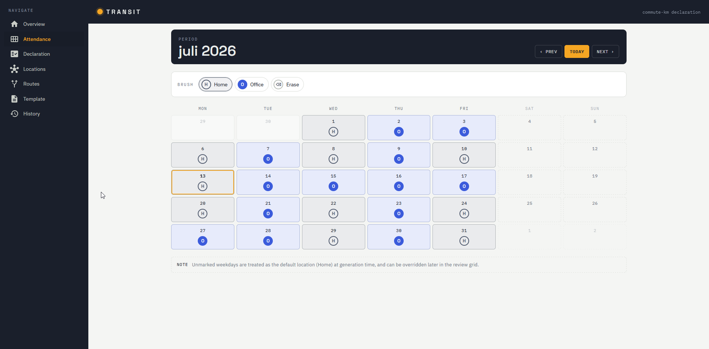

# Transit

A self-contained Blazor web application that automates the monthly commute-kilometre
(woon-werkverkeer) declaration. It runs locally on your work laptop at
`http://transit.local:8083` (also `http://localhost:8083`) and handles the entire flow — from
marking attendance day by day, through reviewing a travel route for each travel day, to filling
the employer-provided Excel template, signing the PDF, and handing you a ready-to-send email.

No external services, no secrets, no network dependency. Everything is stored in a local
SQLite database and a folder on disk.

---



*Attendance calendar — brush-paint your work location per day, then generate the declaration
from the review grid.*

---

## The monthly workflow

1. **Get nudged.** From the first weekday of a new month, a desktop toast says
   *"August 2026 isn't declared yet"*. **Declare** opens the declaration page on that month.
   The toast keeps coming (at logon and midday) until the month is declared, so a laptop that
   was off on the 1st still gets reminded.
2. **Review and sign.** Check the review grid, then click **Generate & sign**. The PDF gets
   your name in a handwriting font plus today's date in the template's signature block, is
   saved to History, and is copied to your export folder.
3. **Send.** Click **Open draft**. The downloaded `.eml` opens in Outlook as a new message with
   the recipient, subject, body and signed PDF already in place. Insert your Outlook signature
   and send.

## Features

- **Brush-model calendar** — select an active location (Home, Office, or any custom location)
  and click days to paint them. Clicking a painted day clears it.
- **Review grid** — pull a full month, see every weekday defaulted and editable, assign a
  travel route per travel day, then generate. Deep-linkable per month
  (`/declaration?month=2026-08`).
- **Excel + PDF generation** — fills the employer's own `.xlsx` template in place (preserving
  formatting and formulas) and converts it to PDF via LibreOffice headless.
- **Generate & sign** — map a `SignatureName` and a `SignatureDate` cell on the template page
  and generating becomes the signing act: the PDF gets your name in a script font and the
  date you clicked Generate. Only the PDF is signed; the stored `.xlsx` stays unsigned.
  Nothing is ever signed in the background.
- **Finance email** — subject and body templates with `{maand}`, `{Maand}`, `{jaar}` and
  `{naam}` tokens, edited with a live preview on the settings page. After generating you get
  **Open draft** (an `.eml` with the PDF attached that classic Outlook opens as an editable
  message), **Open in Outlook** (a `mailto:` link, without attachment), and copy buttons.
- **Export folder** — optionally copy each signed PDF to a folder of your choice (for example
  a OneDrive folder), named like the download: `MM_yyyy_reiskosten_<initials>.pdf`.
- **Desktop reminders** — a daily toast to log today's work location with one click (with a
  suggestion when a location's Wi-Fi hint matches), and the month-end "declare" toast.
- **Configurable template mapping** — map data fields to columns and static header cells
  through the UI; survives the employer changing the sheet layout.
- **Append-only history** — every generation creates an immutable run with its `.xlsx` and
  `.pdf`; re-running a month creates a new run and never overwrites the old one.
- **History preview** — open any past run in a read-only modal that renders the stored sheet,
  formula totals included.
- **User-defined work locations** — arbitrary named locations with a colour, a travel flag,
  an optional postcode (used for the template's `van`/`naar` columns), an optional Wi-Fi hint,
  and exactly one designated as the default for unmarked days.
- **Directed routes** — routes connect two locations with separate outbound and return km,
  handling real-world asymmetry. A per-destination default is pre-selected in the review grid.

## Requirements

- Windows (IIS).
- .NET 10 SDK (installed by the script if missing).
- ASP.NET Core Hosting Bundle 10 (installed by the script if missing).
- LibreOffice (installed via Chocolatey if missing; required for PDF conversion).
- Chocolatey — only needed if LibreOffice is not already installed.
- Classic Outlook, for the one-click email draft (the `mailto:` link and copy buttons work
  with any mail client).

## Installation

The repository ships with `scripts\Install-Transit.ps1`, an idempotent PowerShell script that
provisions everything on a bare Windows machine and deploys the app. It is also the way to
update an existing installation to the latest commit.

**What the script does:**

1. Self-elevates to Administrator.
2. Enables the required IIS Windows features.
3. Installs the .NET 10 SDK if absent.
4. Installs the ASP.NET Core Hosting Bundle if absent and bounces IIS to load the module.
5. Installs LibreOffice via Chocolatey if absent.
6. Creates (or reconciles) the `Transit` IIS app pool (No Managed Code) and the `transit`
   website on port 8083.
7. Creates the data folder under `C:\ProgramData\Transit` and grants the app-pool identity
   Modify access.
8. Adds `transit.local` to the hosts file and a matching host-header binding.
9. Runs the test suite — the deploy is aborted if any test fails.
10. Publishes the app to `C:\inetpub\wwwroot\Transit` and smoke-checks it.
11. Installs the BurntToast module and registers the reminder Scheduled Tasks (at logon and
    at midday) plus the `transit:` URI handler used by the toast's one-click buttons.

**To install or update:**

```powershell
# From inside the cloned repository:
make install
# or directly:
.\scripts\Install-Transit.ps1
```

Re-run it after pulling changes: the site and the reminder helper under
`C:\ProgramData\Transit` are copies and only update on install. Steps that are already done
are skipped. If the .NET SDK or Hosting Bundle installer flags that a reboot is required
(exit code 3010), reboot and re-run it before the app will work.

Optional parameters: `-ReminderMiddayTime '13:00'`, `-ReminderLogonDelayMinutes 5`, and
`-NoReminder` to remove the reminder tasks.

## First-time setup

After installing, open `http://transit.local:8083` and work through:

1. **Locations** and **Routes** — your places (with postcodes) and the km between them.
2. **Template** — upload the employer `.xlsx` and map columns and header cells. For signing,
   add two cell mappings: `SignatureName` on the cell under *Handtekening* and `SignatureDate`
   on the cell next to *Datum*. Leave their values empty: the name falls back to your
   `EmployeeName` mapping and the date is the day you generate.
3. **Settings** — the finance recipient, the email wording, and optionally an export folder.
   **Check** verifies Transit can write there; if not, it shows the `icacls` command that
   grants the IIS app pool access. Tip: Explorer's *Copy as path* (Ctrl+Shift+C) pastes fine.

**Signature font.** The signature uses Segoe Script (ships with Windows) at 16pt. To change
it, edit `src\Transit.Web\appsettings.json` before publishing. The font must be installed
machine-wide, because LibreOffice silently substitutes a missing font.

```json
{
  "Transit": {
    "Signature": { "FontName": "Segoe Script", "FontSize": 14 }
  }
}
```

**Customising the data root.** The default data location is `C:\ProgramData\Transit\Data`.
To use a different path, set `Transit:DataRoot` in `appsettings.json` before publishing, and
update the `$DataRoot` constant at the top of the install script so it creates and ACLs the
right folder.

## Durability and backup

`C:\ProgramData\Transit\Data` is the only copy of your attendance history and your signed-
declaration archive. It contains the SQLite database, uploaded templates, and every generated
`.xlsx` and `.pdf`. There is no in-app backup, and the export folder only holds the latest
PDF per month. Back up the data folder to a second location (a scheduled copy or an
off-machine sync) so a laptop failure does not lose months of records.

## Build and run locally (development)

```powershell
dotnet restore
dotnet build
dotnet run --project src/Transit.Web
```

Run it from an elevated terminal: by default it uses the installed data folder, which only
the IIS app pool (and administrators) can write. To use a throwaway database instead, set
`$env:Transit__DataRoot = "$env:TEMP\transit-dev"` first.

Schema changes are applied automatically on startup. To add a migration:

```powershell
dotnet ef migrations add <Name> `
    --project src/Transit.Infrastructure `
    --startup-project src/Transit.Web
```

## Tests

```powershell
dotnet test
```

Core domain logic (km computation, route and location default resolution, unmarked-day
defaulting, mapping and signature resolution, travel-only export filtering, email rendering
and `.eml` building, the month-end reminder rule) is unit-tested with no I/O. The Excel writer
is tested against a template fixture. The PDF converter tests are skipped when LibreOffice is
not installed; one of them checks that the signature font is really embedded in the PDF.

## Architecture overview

```
Transit.slnx
  src/
    Transit.Core            # domain entities, interfaces, pure services, km logic
    Transit.Infrastructure  # EF Core + SQLite, ClosedXML, LibreOffice, filesystem
    Transit.Web             # Blazor Server UI + composition root
  tests/
    Transit.Tests           # xUnit
  scripts/                  # installer, reminder helper, transit: URI handler
```

Dependency direction: `Web -> Infrastructure -> Core`. `Core` has no I/O dependencies.
All filesystem, database, and subprocess work lives behind interfaces in `Infrastructure`.

For the full design rationale, open [`docs/ARCHITECTURE.md`](docs/ARCHITECTURE.md).

## License

Private — all rights reserved.
