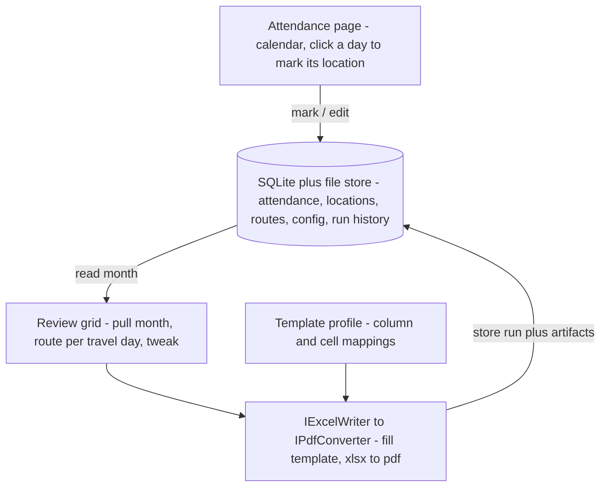

# ARCHITECTURE.md

> Status: **draft, deliberately open to change.** This captures the design we agreed at
> the outset. Where a decision is genuinely unsettled it is marked as an open question
> in §12 rather than pretended to be final.

## 1. Purpose & scope

Automate the monthly commute-kilometre (woon-werkverkeer) declaration.

Today the process is manual: remember where you worked each day, remember which route you
took, transcribe it into an employer-provided Excel template, convert to PDF, sign. This
application removes the remembering and the transcription.

It is a **single Blazor web app** running on the work laptop at `localhost:83`. It owns the
whole flow:

- **Capture** — an in-app calendar page to mark, per date, the work location (Home, Office,
  or any user-defined location) with a click. Duration is irrelevant; only the location per
  date matters.
- **Declare** — pull a month of captured data, assign a travel route per travel day, fill
  the employer Excel template, convert it to PDF, keep a history, and offer downloads.

There is **no separate capture app and no external store.** An earlier draft put capture in
Home Assistant with the laptop pulling over Tailscale; that is not viable (no Tailscale on
the work laptop, and the personal HA instance is off-limits for this), so capture and the
system of record both live in this app.

**Non-goals:** time tracking, payroll, multi-user access, mobile capture, external network
dependencies. Single user, single laptop, single employer template.

## 2. System overview

One process, one SQLite database, one filesystem area for artifacts. Nothing leaves the
laptop.



## 3. Attendance capture (in-app)

**Decision: capture is a page in this app, backed by the same SQLite database.** The app is
already always-local on the laptop, so it is the natural — and only reachable — place to
record days.

**Marking UX — "brush" model.** A single-select control chooses the active location; clicking
a day paints it with that location; clicking a day that already holds the active location
clears it. This makes bulk entry fast ("I was in the office Mon/Wed/Fri" = select Office,
click three days) and back-filling forgotten days trivial.

- Month navigation, defaulting to the current month, with a "Today" jump.
- A Mon–Sun calendar grid. Weekends are visually muted but still markable.
- A standing note that unmarked weekdays are treated as the default location (Home) at
  generation time, and can be overridden in the review grid.
- Location management: add / rename / recolour, set which counts as a travel day, and which
  is the default for unmarked days.

**Only explicitly-marked days become `AttendanceEntry` rows.** Absence of a row means
"unmarked", which the declaration step resolves to the default location. This is why a
forgotten day safely becomes WFH rather than an error.

The store sits behind `IAttendanceStore`, so if a different source is ever wanted (an
external service, an import), it is a one-class change. The default implementation reads and
writes the local SQLite directly — no network hop, no API surface required. A thin localhost
read endpoint could be added later if a programmatic consumer appears, but none exists today.

## 4. Application components

### UI (Blazor Web App, `InteractiveServer` render mode)

Server interactivity is chosen because everything interesting is server-side (filesystem,
Excel/PDF libraries, DB). No client API surface to build; direct library access.

- **Attendance page** — the calendar marking surface described in §3.
- **Declaration page** — pick month → pull → review grid (date, location, editable route per
  travel day, default pre-selected) → generate. After a generate with a PDF, an `EmailPanel` shows the
  rendered finance email (copy subject/body, or *Open in Outlook* via a `mailto:` link — the PDF is
  attached by hand; `mailto:` cannot carry attachments).
- **Locations & routes page** — CRUD over work locations (with the travel and default-for-
  unmarked flags) and over routes (with outbound/return km and a default).
- **Template / config page** — upload the employer template; map fields to columns and static
  header cells; list all saved profiles and activate / rename / delete one; set the active profile.
- **History page** — a year-paged 4×3 month grid (navigation like `/attendance`). Declared months are
  coloured and expose the latest run's `.xlsx`/`.pdf` download + delete on the tile; the current month is
  highlighted. Clicking a declared tile opens a per-month modal listing every run (append-only history)
  with preview (read-only, via `ISheetPreviewReader`), download, and delete. Grouping is the pure
  `HistoryCalendar` helper; no store change. The header shows a **year travel-distance total** (via the
  shared `TravelKmCounter`), summing the latest run per declared month — `DeclarationRunSummary.TotalKm`
  is projected from each run's frozen travel rows, so re-runs never double-count.
- **Settings page** — the declaration email: recipient, subject and body templates with a live preview
  for the previous month. Tokens `{maand}`/`{Maand}`/`{jaar}`/`{naam}` (pure `EmailComposer`: fixed
  set, plain replaces, unknown tokens kept as typed; `{naam}` = the active template's EmployeeName).
- **Overview page (home)** — a status dashboard + launchpad: this month's capture counts, a nudge to
  declare the previous month, a location breakdown, recent runs with downloads, and setup health.

### Services

- `IAttendanceStore` → `SqliteAttendanceStore` — read a date range; set/clear a day's location.
- `LocationService` — location CRUD; resolve the default-for-unmarked location.
- `RouteService` — route CRUD; default resolution.
- `IExcelWriter` → `ClosedXmlTemplateWriter` — load the template and write per the active
  `TemplateProfile`, preserving formatting and formulas. An optional `signedOn` date also fills the
  signature cells (name in the `SignatureOptions` handwriting font); without it they stay blank.
- `IPdfConverter` → `LibreOfficePdfConverter` — invoke `soffice --headless --convert-to pdf`.
- `ITemplateProfileStore` — persist template file + mappings; select active; rename; delete.
- `IArtifactStore` → `FileSystemArtifactStore` — write/read/delete generated files under
  `generated\{yyyy-MM}\{runId}\`; hand back paths.
- `ISheetPreviewReader` → `ClosedXmlSheetPreviewReader` — read a sheet's used range into display
  strings (evaluating formulas) for the read-only history preview.
- `IDeclarationRunStore` → `SqliteDeclarationRunStore` — run metadata + frozen rows (DB only).
- `DeclarationHistoryService` — owns the run+artifact lifecycle (save, list, open, delete),
  coordinating the two stores above.
- `GenerationService` — active profile → reviewed draft (defaults + route overrides) → write xlsx
  (unsigned) and a signed copy (today's date, via `TimeProvider`) → convert the signed copy to pdf →
  persist an append-only run + artifacts.
- `ISettingsStore` → `SqliteSettingsStore` — the single `AppSettings` row; defaults until saved.
- `DeclarationEmailService` — loads settings + the active template's employee name, delegates to the
  pure `EmailComposer`.

### Persistence

EF Core + **SQLite** for all metadata *and* the attendance system of record; the
**filesystem** for the uploaded template and generated artifacts.

## 5. Data model

```
WorkLocation
  Id, Name, ColorHex,
  CountsAsTravel (bool),          // Office = true, Home = false
  IsDefaultForUnmarked (bool),    // exactly one; Home
  Postcode (string?)              // optional; feeds the template's van/naar postcode columns
  NetworkHint (string?)           // optional Wi-Fi name; the reminder suggests this location when connected


Route
  Id, Name
  FromLocationId  ->  ToLocationId              // directed connection between two locations
  OutboundKm (decimal), ReturnKm (decimal)      // From->To and To->From legs, stored separately
  IsDefault (bool)                              // the default among routes sharing this ToLocationId
  TotalKm => OutboundKm + ReturnKm              // handles home->office vs office->home asymmetry

AttendanceEntry                   // one per explicitly-marked date; system of record
  Date (DateOnly), WorkLocationId

TemplateProfile
  Id, Name, TemplateFilePath, SheetSelector (name or index),
  DataStartRow (int),                // first repeating-data row (8 for the Truston template)
  DataRowCount (int),                // physical data rows present (15); writer inserts beyond this
  IsActive (bool), CreatedUtc
  ColumnMappings : ColumnMapping[]   // repeating rows
  CellMappings   : CellMapping[]     // static header fields

ColumnMapping
  Field  : enum { Date, WeekdayName, FromLocation, ToLocation, FromPostcode, ToPostcode, RouteName, OutboundKm, ReturnKm, Kilometers }
  Column : string   // e.g. "A", "B"
  Format : string?  // e.g. "dd-MM-yyyy", "0.0"

CellMapping
  CellRef : string  // e.g. "C1"
  Source  : enum { MonthName, Year, EmployeeName, PersonnelNumber, Custom, SignatureName, SignatureDate }
  Value   : string? // for Custom / static overrides; SignatureName falls back to the EmployeeName literal
  Format  : string? // SignatureDate: .NET date format, default "dd/MM/yyyy" (written as a string)

DeclarationRun
  Id, PeriodYear, PeriodMonth,
  TemplateProfileId, TemplateName,        // TemplateName frozen — survives profile rename/delete
  CreatedUtc,
  XlsxFilePath, PdfFilePath?              // PdfFilePath null on an xlsx-only run (PDF conversion failed)
  Rows : DeclarationRow[]                 // ALL reviewed rows frozen (travel + non-travel)

DeclarationRow                            // frozen DeclarationDraftRow + FK
  Date, WeekdayName, WorkLocationId, LocationName, ColorHex, CountsAsTravel, IsUnmarkedDefault,
  RouteId?, RouteName?,                    // RouteName frozen as a string
  FromLocationName?, FromPostcode?, ToLocationName?, ToPostcode?,
  OutboundKm, ReturnKm, Kilometers, HasNoRoute

AppSettings                               // single row, Id = 1; absent row = defaults
  EmailRecipient?,
  EmailSubjectTemplate, EmailBodyTemplate // tokens {maand} {Maand} {jaar} {naam}
```

**Km rule:** travel day (`CountsAsTravel`) → chosen route's `TotalKm`
(`OutboundKm + ReturnKm`); non-travel day → `0`. Monthly totals are **not** computed here —
the template's own `SUM` formula owns them.

**Route resolution:** a travel day is marked with one location; its route is pre-selected by
matching routes whose `ToLocationId` equals that location (origin is implicitly the
`IsDefaultForUnmarked` location), choosing the destination's default. A travel day whose location
has no matching route is shown flagged with km `0`, never silently zeroed. Route selection in the
review grid is editable and, until a run is generated (slice 4), in-memory only.

**Declaration compute:** a pure `DeclarationBuilder` (Core, no I/O) materialises the rows, defaults
unmarked days, resolves routes, and computes km; a thin `DeclarationService` loads attendance,
locations (incl. archived), and routes, then delegates to it. Each `DeclarationDraftRow` also
carries the resolved route's endpoint detail — `FromLocationName` / `FromPostcode` /
`ToLocationName` / `ToPostcode` (null on non-travel and no-route rows) — so the Excel writer can
fill the template's `van` / `naar` / postcode columns without re-querying locations.

**Row generation & defaulting:** the review grid materialises every weekday of the period,
plus any explicitly-marked weekend day. Dates with an `AttendanceEntry` use it; unmarked
weekdays fall back to the `IsDefaultForUnmarked` location. Every row is editable before
generation. **Export filters to `CountsAsTravel` rows only** — WFH/absent days never reach
the sheet.

## 6. Excel-writer configurability

The writer must survive the employer changing the sheet layout, so mapping is data, not
code. A `TemplateProfile` describes:

- which **sheet** (`SheetSelector`), which **row** the repeating data starts on
  (`DataStartRow`), and how many physical data rows the template ships with (`DataRowCount`);
- **column mappings** for the repeating rows — `Date` → col A, `Kilometers` (day total) → col
  F, `FromLocation` / `ToLocation` and their postcodes to the `van` / `naar` columns, and
  optionally `WeekdayName`, `RouteName`, and the individual `OutboundKm` / `ReturnKm` legs —
  each with an optional format string;
- **cell mappings** for static header fields (month name, year, employee name, personnel
  number, or a custom literal) written to specific cells, plus the two **signature cells**
  (`SignatureName`, `SignatureDate`) that are written only into the PDF's workbook.

`ClosedXmlTemplateWriter` **loads the uploaded template and writes into it** — it never
rebuilds the workbook — so formatting, merged cells, and formulas are preserved. It writes
**only `CountsAsTravel` rows** (WFH/absent days never reach the sheet) and never writes a
monthly total — the template's own `SUM` owns it. When a month has more travel days than
`DataRowCount`, it **inserts rows inside the data block** so the `SUM` range expands and the
signature block below shifts down. Profiles are versioned; one is active. A dry-run preview
highlights the cells the active mapping would write, on the config page.

**Generation is durable and append-only (slice 5):** `GenerationService` orchestrates active-profile
→ reviewed draft (defaults + the review grid's route overrides) → fill xlsx → convert pdf, then
`DeclarationHistoryService` persists a new `DeclarationRun` (frozen rows) and writes the artifacts
under `generated\`. The bytes still stream to the browser; re-running a month makes another run and
never overwrites history. A PDF-conversion failure yields an xlsx-only run.

**Generate & sign.** When the active profile maps a `SignatureName` cell, `/declaration` labels the
button *Generate & sign*: clicking it is the signing act — nothing signs unattended. The template is
filled twice from the same draft: the **unsigned** fill is the stored/downloaded xlsx (and what the
history preview renders); the **signed** fill — name in a handwriting font (`Transit:Signature`
`FontName`, default Segoe Script, which ships with Windows), date = the day Generate was clicked — is
only ever converted to the PDF and never stored. The signature is the employee's name in a script
font, exactly as Adobe's typed signature; there is no secret to store or protect. A missing font is
silently substituted by LibreOffice, so pick one installed machine-wide.

## 7. PDF conversion

**Default: LibreOffice headless** as a subprocess. Free, good `.xlsx` fidelity, and the PDF is
the artifact that gets signed, so fidelity matters. Requires LibreOffice installed on the
laptop.

Explicitly rejected: **Office/COM automation** (`Microsoft.Office.Interop.Excel`) — Microsoft
does not support Office automation from a service/IIS context; it is unreliable and a support
dead end. Managed alternatives (Syncfusion `XlsIO`, GemBox.Spreadsheet, Aspose.Cells) are
viable if LibreOffice can't be installed — hence the `IPdfConverter` seam.

**Visual signing** is done upstream, in the workbook the PDF is converted from (see §6
*Generate & sign*). Certificate-based digital signing (PAdES) is out of scope — it needs a signing
library and a certificate the receiver trusts; it would be a future `IPdfConverter` decorator.

## 8. Storage layout

```
C:\ProgramData\Transit\Data        # configurable via Transit:DataRoot (StorageOptions)
  app.db                           # SQLite: attendance, locations, routes, config, runs
  templates\{profileId}\template.xlsx
  generated\{yyyy-MM}\{runId}\
    declaration.xlsx
    declaration.pdf
```

The data root lives outside `inetpub` so a republish or reimage of the site does not touch attendance history. The IIS app-pool identity needs write ACL on this folder. The DB holds metadata and file paths; the files live on disk. Generation is **append-only**:
re-running a month creates a new run and new artifacts; it never overwrites history.

## 9. Deployment & durability

- Work laptop, IIS, site bound to `http://localhost:83` (loopback only — not exposed on the
  work network).
- ASP.NET Core Hosting Bundle installed; app published (framework-dependent is fine).
- LibreOffice installed locally for conversion.
- **No external network dependency and no secrets** — the app is fully self-contained.
- 
### Attendance reminder

IIS hosts the app in Session 0 as a service account, which cannot raise Windows toast
notifications. The reminder therefore lives in a desktop-session helper, not the app:

- `GET /api/reminder/today-status?network=…` (loopback, no auth) returns
  `{ date, explicitlyLogged, suggestion?, options[] }`. `explicitlyLogged` comes from the pure
  `AttendanceStatus.IsExplicitlyLogged` — the silent Home-default never counts as logged.
  `suggestion` is the active location whose `NetworkHint` matches a connected network
  (`NetworkHintMatcher`); `options` are up to four locations for toast buttons, suggestion first
  (`ReminderChoices`). The request also warms a cold app pool.
- `POST /api/reminder/log-today` `{ date, locationId }` — the **only write endpoint**. Loopback
  remote address enforced, JSON body only (no CORS policy, so web pages cannot call it). The pure
  `QuickLogRules` allows it only for today, only to an active location, and never over an existing
  mark: `Logged` 200, `AlreadyLogged`/`StaleReminder` 409, `UnknownLocation` 404. Writes through
  `IAttendanceStore.SetAsync`.
- `scripts/Remind-Transit.ps1` runs in the interactive user session via two Scheduled
  Tasks (logon +5 min, daily midday), registered by `Install-Transit.ps1`. It guards
  weekends, sends the connected network names, and — if today is unlogged or the app is
  unreachable (fail-open, Open-only) — shows a BurntToast toast with one button per option
  (`transit:log?location={id}&date={date}`) plus **Open**.
- `scripts/Log-Transit.ps1` is the `transit:` URI handler (HKCU, registered by the installer,
  launched via `conhost --headless`). It strictly parses the URI, POSTs to `log-today`, and shows
  a result toast. A toast clicked on a later day is rejected as stale because the date travels in
  the URI. HKCU belongs to the account running the elevated installer (correct for same-user UAC).

Configuration is by installer parameters (`-ReminderLogonDelayMinutes`,
`-ReminderMiddayTime`, `-NoReminder` — which also removes the `transit:` handler); there is no
runtime config file.

**Durability note (important):** `DataRoot` (`app.db` + `templates\` + `generated\`) is now the
*only* copy of your attendance history **and your signed-declaration history** — `generated\` holds
every run's `.xlsx`/`.pdf`. Back up the whole `DataRoot` folder (a scheduled copy or a sync to
another machine) so a laptop failure or reimage doesn't lose months of records. There is no in-app
backup — it is a folder-level responsibility.

## 10. Key decisions

| Decision | Choice | Why | Alternatives considered |
|---|---|---|---|
| Capture | In-app calendar page | No Tailscale/HA available; app is already always-local | HA + external store over Tailscale (rejected: unreachable) |
| Store | Local SQLite, behind `IAttendanceStore` | Single self-contained system of record | External microservice / calendar |
| Locations | User-defined `WorkLocation` entity | Arbitrary locations (home, office, sites) | Fixed Office/WFH enum |
| Routes | Directed between-location pairs, per-destination default | Future-proofs multiple destinations; asymmetric legs | Global route list (rejected: single-office only); route per location (rejected: no asymmetric named endpoints) |
| Route delete | Hard delete (with confirm) | No inbound persistent reference; run snapshots freeze RouteName | Archive (rejected: needless machinery) |
| Declaration | Pure `DeclarationBuilder` + thin `DeclarationService` | Km/defaulting stays pure and unit-tested | Service does everything (rejected: entangles I/O with logic) |
| Declaration UI | Blazor Server (`InteractiveServer`) | Server-side file/lib access; no client API | Blazor WASM; MVC |
| Metadata store | SQLite + EF Core | Single-user, file-based, zero-admin | LiteDB; JSON files |
| Excel | ClosedXML, write into template | Preserves formatting/formulas | OpenXML SDK (fallback) |
| PDF | LibreOffice headless (behind `IPdfConverter`) | Free, good fidelity, server-safe | Syncfusion/GemBox; COM (rejected) |
| Km model | Route `OutboundKm` + `ReturnKm` | Direction asymmetry (~1.6 km each way) | Single one-way ×2 (rejected: ignores asymmetry) |
| Unmarked days | Default to designated location (Home), editable | Only travel days are declared; missing = WFH | Force-mark every day |
| Totals | Left to template formulas | Survives template changes | Compute + write |
| Km column layout | Single total-km column, one row per travel day | Matches the real Truston template (`aantal km`, 15-row block) | Outbound/return split (template has no split columns) |
| Header fields | Employee name + month only | The real template has exactly these two | Personnel number / year cell / cost centre (not present) |
| Postcode source | Optional `WorkLocation.Postcode` | Postcode belongs to a place; auto-fills `van`/`naar` | On `Route` (duplicates); unmapped (repetitive manual entry) |
| Row overflow | Auto-insert rows inside the SUM range | Fits any month; format-agnostic per the generic mapping goal | Cap+warn (blocks heavy months); capacity as setting (deferred) |
| Slice-4 generation | Ephemeral generate + download only | Clean 4/5 boundary; all persistence lands together in slice 5 | Persist artifacts now (orphan files); full run now (crosses boundary) |
| Generation orchestration | New `GenerationService` | Keeps the pure builder/orchestrator split intact | Fold into `DeclarationService` (entangles concerns) |
| Generate persistence | Always persist an append-only run | History is the record of every generation; a save-later state risks an unrecorded filing | Separate save action; persist-without-auto-download |
| PDF-conversion failure | Persist an xlsx-only run, no retry | The xlsx is the valuable, signable artifact; keeps runs write-once | Regenerate-PDF-in-place (mutates a run); fail the whole generate |
| Run lifecycle | Immutable content + manual hard-delete (confirm), no auto-prune | Append-only holds; a mistaken run is still removable; auto-deleting a compliance record is dangerous | Fully immutable; delete + retention policy |
| Reviewed rows at generation | Thread the grid's route overrides into generation | Makes "freeze the reviewed rows" literally true; closes the slice-4 gap | Server-rebuild from defaults; persist overrides per day |
| History coordination | A `DeclarationHistoryService` over two dumb stores | One tested place owns DB-and-disk; page + generator stay thin | Fold into `GenerationService`; page coordinates both stores |
| Signature | Name in a script font + generate date, written into template cells before PDF conversion | Mirrors Adobe's typed signature; no secret, no new dependency, reuses cell mappings | Stamped PNG (image storage + DPAPI for no real gain); PAdES certificate signing (library + trusted cert) |
| What gets signed | PDF only; stored xlsx stays unsigned (template filled twice) | The PDF is what's handed in | Sign both (signature leaks into the editable file) |
| When signing happens | Only on an explicit Generate click | Signing attests the reviewed rows; unattended signing bypasses review | Auto-generate + sign on the 1st |
| Email templating | Fixed token set, plain string replaces | Covers month/year/name without a parser; typos stay visible | Hardcoded text (code change per wording); a templating engine (overkill) |
| Settings storage | Single-row `AppSettings` table behind `ISettingsStore` | Editable in the UI, survives republish, one home for future settings | `appsettings.json` (clumsy under IIS, overwritten on publish); on `TemplateProfile` (lost on new template version) |
| Email hand-off | Copy buttons + `mailto:` link; PDF attached manually | No Office automation, works with any mail client | `.eml` draft with attachment (deferred until verified on the user's Outlook) |
| Signature date format | Pre-formatted string | A "/" in a sheet number-format follows the locale separator (nl-NL "-") | Date value + number-format |

## 11. Cross-cutting concerns

- **Dates are `DateOnly`, local.** No `DateTime`, no UTC round-tripping for calendar days — a
  declaration day is a wall-clock date, and timezone drift must not shift it.
- **Unmarked days are visible, never silent.** The review grid shows every weekday, defaulted
  and editable, before anything is written.
- **Idempotent, append-only generation.** History is immutable.
- **Local-only exposure.** The app binds to loopback; there is no external API.

## 12. Open questions / to confirm

1. ~~**Routes are currently global.**~~ **Resolved:** routes are directed connections between two
   locations (`FromLocationId` → `ToLocationId`) with asymmetric legs and a per-destination
   default. This future-proofs multiple travel destinations without a schema change; the single
   office today is simply the one destination that has a route.
2. ~~**Km column layout.**~~ **Resolved (slice 4):** the real Truston template has a single
   `aantal km` total column (col F) and a 15-row data block, so the writer emits **one row per
   travel day** with the round-trip total km. No outbound/return split.
3. ~~**Personal header fields.**~~ **Resolved (slice 4):** the template needs exactly two static
   header fields — employee name and month. No personnel number, year cell, or cost centre.
4. **Calendar toggle semantics** — clicking a day that already holds the active location
   clears it (assumed). Confirm that's the desired "undo" gesture.

Resolved since the first draft: capture mechanism (in-app), reachability (n/a),
one-way-vs-round-trip (now outbound + return), missing-day handling (default to Home,
editable), template row model (travel days only), the routes model (directed between-location
pairs, per-destination default), and the template km-column layout + header fields (slice 4).

## 13. Build order

The app is built in vertical slices, each its own spec → plan → implementation cycle and each
producing working, testable software on its own. Specs live in `docs/superpowers/specs/`.

1. **Foundation + minimal capture** *(done)* — four-project restructure, EF Core + SQLite at
   `C:\ProgramData\Transit\`, MudBlazor, and a brush-model attendance calendar that persists
   marks. The walking skeleton that exercises the whole stack end-to-end.
2. **Attendance capture (full)** *(done)* — `WorkLocation` CRUD (`LocationService` write side), brush
   polish, and a design language established via `/frontend-design` (MudBlazor theme tokens)
   that sets the visual vocabulary for every later page.
3. **Routes + declaration review** *(done)* — `Route` / `RouteService`, `DeclarationService`
   (pull → default unmarked → km), and the editable review grid.
4. **Template + Excel + PDF** *(done)* — `TemplateProfile` + `ITemplateProfileStore`,
   `IExcelWriter` (ClosedXML), `IPdfConverter` (LibreOffice headless), `GenerationService`, the
   `/template` config page, and a Generate action that streams `.xlsx` / `.pdf` (ephemeral —
   nothing persisted).
5. **History** *(done)* — `DeclarationRun`/`DeclarationRow` persistence, `IArtifactStore` +
   `FileSystemArtifactStore`, `IDeclarationRunStore`, `DeclarationHistoryService`, durable artifacts
   under `generated\`, the `/history` page, and `.xlsx`/`.pdf` re-downloads. Generation is now
   append-only; the reviewed grid's route overrides are threaded into generation.

Post-slice-5 enhancements: an Overview dashboard (home page) and a read-only history sheet-preview
modal, sharing an `ISheetPreviewReader` seam. See
`docs/superpowers/specs/2026-07-12-overview-history-preview-design.md`.

## 14. Design language & theming

The visual vocabulary is **"Wayfinding"**: locations read as transit lines, days as stops, and
the working surface as a departure/schedule board. Boldness is spent in one place — the line
bullet and the ink board — everything else stays quiet. It lives in two coordinated files:

- **`src/Transit.Web/wwwroot/tokens.css` — the source of truth.** CSS custom properties
  (`--tr-*`) for palette, type, and shape, plus the custom component classes (`.tr-bullet`,
  `.tr-board`, `.tr-day`, `.tr-brush`, `.tr-note`, …). Every custom selector is prefixed
  `tr-` / `--tr-` so it never collides with Bootstrap or MudBlazor.
- **`src/Transit.Web/Theme/TransitTheme.cs` — a `MudTheme` mirror.** It restates the same
  palette and typefaces so built-in MudBlazor components match the custom vocabulary. Applied
  through the `MudThemeProvider`.

**Sync rule (careful zone):** `tokens.css` is authoritative; `TransitTheme.cs` mirrors it by
hand — they are *not* generated from each other. A palette/type/shape change in one **must** be
made in the other in the same change, or MudBlazor components and custom markup drift apart.

Fonts — Space Grotesk (display), IBM Plex Sans (body), IBM Plex Mono (mono) — are loaded in
`App.razor`. Component markup consumes the tokens and `tr-` classes; it never hard-codes
colours. Each future `/frontend-design` pass updates these two files, not the pages.
