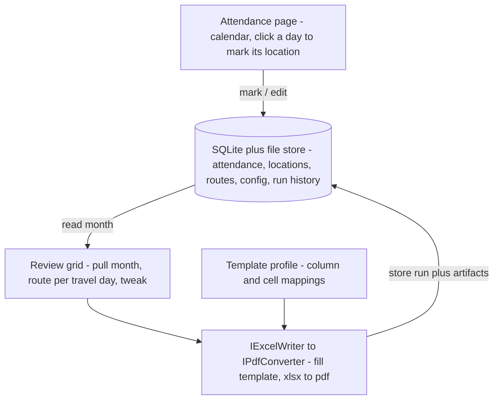

# ARCHITECTURE.md

> Status: **draft, deliberately open to change.** This captures the design we agreed at
> the outset. Where a decision is genuinely unsettled it is marked as an open question
> in §12 rather than pretended to be final.

## 1. Purpose & scope

Automate the monthly commute-kilometre (woon-werkverkeer) declaration.

Today the process is manual: remember where you worked each day, remember which route you
took, transcribe it into an employer-provided Excel template, convert to PDF, sign. This
application removes the remembering and the transcription.

It is a **single Blazor web app** running on the work laptop at `localhost:83`. It owns the
whole flow:

- **Capture** — an in-app calendar page to mark, per date, the work location (Home, Office,
  or any user-defined location) with a click. Duration is irrelevant; only the location per
  date matters.
- **Declare** — pull a month of captured data, assign a travel route per travel day, fill
  the employer Excel template, convert it to PDF, keep a history, and offer downloads.

There is **no separate capture app and no external store.** An earlier draft put capture in
Home Assistant with the laptop pulling over Tailscale; that is not viable (no Tailscale on
the work laptop, and the personal HA instance is off-limits for this), so capture and the
system of record both live in this app.

**Non-goals:** time tracking, payroll, multi-user access, mobile capture, external network
dependencies. Single user, single laptop, single employer template.

## 2. System overview

One process, one SQLite database, one filesystem area for artifacts. Nothing leaves the
laptop.



## 3. Attendance capture (in-app)

**Decision: capture is a page in this app, backed by the same SQLite database.** The app is
already always-local on the laptop, so it is the natural — and only reachable — place to
record days.

**Marking UX — "brush" model.** A single-select control chooses the active location; clicking
a day paints it with that location; clicking a day that already holds the active location
clears it. This makes bulk entry fast ("I was in the office Mon/Wed/Fri" = select Office,
click three days) and back-filling forgotten days trivial.

- Month navigation, defaulting to the current month, with a "Today" jump.
- A Mon–Sun calendar grid. Weekends are visually muted but still markable.
- A standing note that unmarked weekdays are treated as the default location (Home) at
  generation time, and can be overridden in the review grid.
- Location management: add / rename / recolour, set which counts as a travel day, and which
  is the default for unmarked days.

**Only explicitly-marked days become `AttendanceEntry` rows.** Absence of a row means
"unmarked", which the declaration step resolves to the default location. This is why a
forgotten day safely becomes WFH rather than an error.

The store sits behind `IAttendanceStore`, so if a different source is ever wanted (an
external service, an import), it is a one-class change. The default implementation reads and
writes the local SQLite directly — no network hop, no API surface required. A thin localhost
read endpoint could be added later if a programmatic consumer appears, but none exists today.

## 4. Application components

### UI (Blazor Web App, `InteractiveServer` render mode)

Server interactivity is chosen because everything interesting is server-side (filesystem,
Excel/PDF libraries, DB). No client API surface to build; direct library access.

- **Attendance page** — the calendar marking surface described in §3.
- **Declaration page** — pick month → pull → review grid (date, location, editable route per
  travel day, default pre-selected) → generate.
- **Locations & routes page** — CRUD over work locations (with the travel and default-for-
  unmarked flags) and over routes (with outbound/return km and a default).
- **Template / config page** — upload the employer template; map fields to columns and static
  header cells; set the active profile.
- **History page** — list past runs; download the `.xlsx` or `.pdf` of each.

### Services

- `IAttendanceStore` → `SqliteAttendanceStore` — read a date range; set/clear a day's location.
- `LocationService` — location CRUD; resolve the default-for-unmarked location.
- `RouteService` — route CRUD; default resolution.
- `IExcelWriter` → `ClosedXmlTemplateWriter` — load the template and write per the active
  `TemplateProfile`, preserving formatting and formulas.
- `IPdfConverter` → `LibreOfficePdfConverter` — invoke `soffice --headless --convert-to pdf`.
- `ITemplateProfileStore` — persist template file + mappings; select active.
- `IArtifactStore` — write/read generated files on disk; hand back paths.
- `DeclarationService` — orchestrates pull → default unmarked → compute km → write xlsx →
  convert pdf → persist run + artifacts.

### Persistence

EF Core + **SQLite** for all metadata *and* the attendance system of record; the
**filesystem** for the uploaded template and generated artifacts.

## 5. Data model

```
WorkLocation
  Id, Name, ColorHex,
  CountsAsTravel (bool),          // Office = true, Home = false
  IsDefaultForUnmarked (bool)     // exactly one; Home

Route
  Id, Name, OutboundKm (decimal), ReturnKm (decimal), IsDefault (bool)
  TotalKm => OutboundKm + ReturnKm        // handles home->office vs office->home asymmetry

AttendanceEntry                   // one per explicitly-marked date; system of record
  Date (DateOnly), WorkLocationId

TemplateProfile
  Id, Name, TemplateFilePath, SheetSelector (name or index),
  DataStartRow (int), IsActive (bool), CreatedUtc
  ColumnMappings : ColumnMapping[]   // repeating rows
  CellMappings   : CellMapping[]     // static header fields

ColumnMapping
  Field  : enum { Date, WeekdayName, Location, RouteName, OutboundKm, ReturnKm, Kilometers }
  Column : string   // e.g. "A", "B"
  Format : string?  // e.g. "dd-MM-yyyy", "0.0"

CellMapping
  CellRef : string  // e.g. "C1"
  Source  : enum { MonthName, Year, EmployeeName, PersonnelNumber, Custom }
  Value   : string? // for Custom / static overrides

DeclarationRun
  Id, PeriodYear, PeriodMonth, TemplateProfileId, CreatedUtc
  Rows : DeclarationRow[]   // frozen snapshot as generated

DeclarationRow
  Date, WorkLocationId, LocationName, CountsAsTravel,
  RouteId?, RouteName, OutboundKm, ReturnKm, Kilometers
```

**Km rule:** travel day (`CountsAsTravel`) → chosen route's `TotalKm`
(`OutboundKm + ReturnKm`); non-travel day → `0`. Monthly totals are **not** computed here —
the template's own `SUM` formula owns them.

**Row generation & defaulting:** the review grid materialises every weekday of the period,
plus any explicitly-marked weekend day. Dates with an `AttendanceEntry` use it; unmarked
weekdays fall back to the `IsDefaultForUnmarked` location. Every row is editable before
generation. **Export filters to `CountsAsTravel` rows only** — WFH/absent days never reach
the sheet.

## 6. Excel-writer configurability

The writer must survive the employer changing the sheet layout, so mapping is data, not
code. A `TemplateProfile` describes:

- which **sheet** (`SheetSelector`) and which **row** the repeating data starts on
  (`DataStartRow`);
- **column mappings** for the repeating rows — `Date` → col A, `Kilometers` (day total) → col
  B, and optionally `WeekdayName`, `Location`, `RouteName`, and the individual `OutboundKm` /
  `ReturnKm` legs — each with an optional format string;
- **cell mappings** for static header fields (month name, year, employee name, personnel
  number, or a custom literal) written to specific cells.

`ClosedXmlTemplateWriter` **loads the uploaded template and writes into it** — it never
rebuilds the workbook — so formatting, merged cells, and formulas are preserved. Profiles are
versioned; one is active. A dry-run preview (which cells would be written) is a nice-to-have
on the config page.

## 7. PDF conversion

**Default: LibreOffice headless** as a subprocess. Free, good `.xlsx` fidelity, and the PDF is
the artifact that gets signed, so fidelity matters. Requires LibreOffice installed on the
laptop.

Explicitly rejected: **Office/COM automation** (`Microsoft.Office.Interop.Excel`) — Microsoft
does not support Office automation from a service/IIS context; it is unreliable and a support
dead end. Managed alternatives (Syncfusion `XlsIO`, GemBox.Spreadsheet, Aspose.Cells) are
viable if LibreOffice can't be installed — hence the `IPdfConverter` seam.

**Signing is out of scope** and handled manually after download. Digital signing (embedding a
certificate-based signature) is a possible future `IPdfConverter` decorator.

## 8. Storage layout

```
C:\ProgramData\Transit\Data        # configurable via Transit:DataRoot (StorageOptions)
  app.db                           # SQLite: attendance, locations, routes, config, runs
  templates\{profileId}\template.xlsx
  generated\{yyyy-MM}\{runId}\
    declaration.xlsx
    declaration.pdf
```

The data root lives outside `inetpub` so a republish or reimage of the site does not touch attendance history. The IIS app-pool identity needs write ACL on this folder. The DB holds metadata and file paths; the files live on disk. Generation is **append-only**:
re-running a month creates a new run and new artifacts; it never overwrites history.

## 9. Deployment & durability

- Work laptop, IIS, site bound to `http://localhost:83` (loopback only — not exposed on the
  work network).
- ASP.NET Core Hosting Bundle installed; app published (framework-dependent is fine).
- LibreOffice installed locally for conversion.
- **No external network dependency and no secrets** — the app is fully self-contained.

**Durability note (important):** the laptop's `App_Data` is now the *only* copy of your
attendance history and generated declarations. Back it up — a scheduled copy or a sync of the
`App_Data` folder to another machine — so a laptop failure or reimage doesn't lose months of
records.

## 10. Key decisions

| Decision | Choice | Why | Alternatives considered |
|---|---|---|---|
| Capture | In-app calendar page | No Tailscale/HA available; app is already always-local | HA + external store over Tailscale (rejected: unreachable) |
| Store | Local SQLite, behind `IAttendanceStore` | Single self-contained system of record | External microservice / calendar |
| Locations | User-defined `WorkLocation` entity | Arbitrary locations (home, office, sites) | Fixed Office/WFH enum |
| Declaration UI | Blazor Server (`InteractiveServer`) | Server-side file/lib access; no client API | Blazor WASM; MVC |
| Metadata store | SQLite + EF Core | Single-user, file-based, zero-admin | LiteDB; JSON files |
| Excel | ClosedXML, write into template | Preserves formatting/formulas | OpenXML SDK (fallback) |
| PDF | LibreOffice headless (behind `IPdfConverter`) | Free, good fidelity, server-safe | Syncfusion/GemBox; COM (rejected) |
| Km model | Route `OutboundKm` + `ReturnKm` | Direction asymmetry (~1.6 km each way) | Single one-way ×2 (rejected: ignores asymmetry) |
| Unmarked days | Default to designated location (Home), editable | Only travel days are declared; missing = WFH | Force-mark every day |
| Totals | Left to template formulas | Survives template changes | Compute + write |

## 11. Cross-cutting concerns

- **Dates are `DateOnly`, local.** No `DateTime`, no UTC round-tripping for calendar days — a
  declaration day is a wall-clock date, and timezone drift must not shift it.
- **Unmarked days are visible, never silent.** The review grid shows every weekday, defaulted
  and editable, before anything is written.
- **Idempotent, append-only generation.** History is immutable.
- **Local-only exposure.** The app binds to loopback; there is no external API.

## 12. Open questions / to confirm

1. **Routes are currently global** — any travel day can pick any route. This assumes a single
   office. If multiple travel destinations at different distances appear, routes may need to
   attach to a location. Confirm the single-office assumption.
2. **Km column layout** — does the employer template want the day's *total* km in one column,
   or the outbound/return legs split across two? Fields exist for both; needs the real sheet.
3. **Personal header fields** — which static fields does the template need (name, personnel
   number, cost centre)?
4. **Calendar toggle semantics** — clicking a day that already holds the active location
   clears it (assumed). Confirm that's the desired "undo" gesture.

Resolved since the first draft: capture mechanism (in-app), reachability (n/a),
one-way-vs-round-trip (now outbound + return), missing-day handling (default to Home,
editable), and template row model (travel days only).

## 13. Build order

The app is built in vertical slices, each its own spec → plan → implementation cycle and each
producing working, testable software on its own. Specs live in `docs/superpowers/specs/`.

1. **Foundation + minimal capture** *(current)* — four-project restructure, EF Core + SQLite at
   `C:\ProgramData\Transit\`, MudBlazor, and a brush-model attendance calendar that persists
   marks. The walking skeleton that exercises the whole stack end-to-end.
2. **Attendance capture (full)** — `WorkLocation` CRUD (`LocationService` write side), brush
   polish, and a design language established via `/frontend-design` (MudBlazor theme tokens)
   that sets the visual vocabulary for every later page.
3. **Routes + declaration review** — `Route` / `RouteService`, `DeclarationService`
   (pull → default unmarked → km), and the editable review grid.
4. **Template + Excel + PDF** — `TemplateProfile`, `IExcelWriter` (ClosedXML), `IPdfConverter`
   (LibreOffice headless), and the template / config page.
5. **History** — `DeclarationRun` persistence, the history page, and `.xlsx` / `.pdf` downloads.
